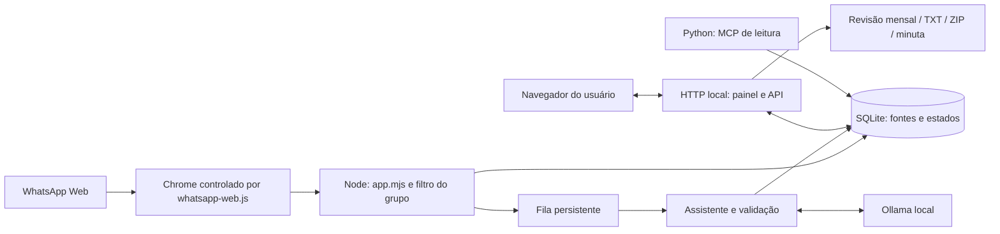

# 1. Negócio e arquitetura

[Índice](README.md) · [Próximo: linguagens](02-linguagens-e-principios.md)

## 1.1 Qual problema estamos resolvendo?

Uma conversa de manutenção mistura ocorrências, fotos, respostas, agradecimentos e atualizações. O responsável precisa acompanhar atendimentos durante o mês e produzir um relatório fiel. Ler tudo novamente no fechamento custa tempo e favorece esquecimentos.

O produto transforma fontes dispersas em chamados rastreáveis, preserva histórico e pendências e prepara material para revisão humana. O painel é a interface desse trabalho; a IA auxilia a organização e a redação.

### Vocabulário do domínio

| Conceito | Significado | Não confundir com |
| --- | --- | --- |
| Fonte | Registro arquivado que sustenta uma informação | Fato automaticamente aprovado |
| Chamado | Atendimento acompanhado com fontes e atualizações | Uma mensagem isolada |
| Fato extraído | Trecho literal associado a um campo | Diagnóstico comprovado pelo modelo |
| Contexto | Local, equipamento, ocorrência, procedimento e resultado/pendência | Conclusão técnica |
| Etapa | Em andamento, aguardando, remarcado, cancelado, concluído ou não identificada | Completude do contexto |
| Competência | Mês de revisão | Data exata de execução do serviço |
| Minuta | Versão preparada para conferência e impressão | Documento final automaticamente aprovado |

**Exemplo fictício:** “Câmera de bancada sem imagem; aguardando fonte de alimentação”. Existe uma ocorrência e uma dependência. O texto não prova substituição, causa ou normalização. O sistema deve preservar essa distinção até a revisão.

## 1.2 Arquitetura em uma imagem

Leitura textual: Node recebe eventos do WhatsApp, valida o escopo e guarda fontes. O assistente analisa texto via Ollama. O navegador consulta e atualiza chamados pela API local. O MCP opcional permite consultas por outro processo. A revisão mensal usa os registros persistidos e decisões humanas.

Não há um servidor de banco independente: SQLite é uma biblioteca que abre um arquivo local. O navegador do painel e o Chrome automatizado do WhatsApp têm papéis distintos.

## 1.3 Mapa do repositório

| Caminho | Responsabilidade | Comece por |
| --- | --- | --- |
| [src/app.mjs](../src/app.mjs) | Composição dos componentes, captura, vínculo, servidor e envio controlado | `capture`, `connect`, `http.createServer` |
| [src/config.mjs](../src/config.mjs) | Padrões e validação da configuração | `CONFIG` |
| [src/core.mjs](../src/core.mjs) | Criptografia, escopo e normalização de fonte | `seal`, `open`, `inScope`, `recordOf` |
| [src/assistant/](../src/assistant/) | Análise, vínculo de respostas, perguntas e confirmações | `ReportAssistant`, `validateAnalysis` |
| [src/whatsapp/](../src/whatsapp/) | Histórico, mídia, compatibilidade, transporte e recuperação | `RecoveryQueue`, `verifyTransport` |
| [src/cases/board.mjs](../src/cases/board.mjs) | Regras e alterações de chamados | `CaseBoard.summary`, `change` |
| [src/cases/stage.mjs](../src/cases/stage.mjs) | Etapa operacional baseada em evidência e ajuste humano | `classifyStage`, `currentStage` |
| [src/cases/http.mjs](../src/cases/http.mjs) | Rotas da Central e entrega dos arquivos da interface | `createCaseHandler` |
| [src/cases/history.mjs](../src/cases/history.mjs) | Fontes sem chamado e vínculos revisados | `HistoricalCases` |
| [src/cases/history-media.mjs](../src/cases/history-media.mjs) | Resposta HTTP de anexos históricos | `sendHistoryMedia` |
| [src/cases/closing.mjs](../src/cases/closing.mjs) | Revisão de fontes, decisões mensais e liberação de minuta | `MonthlyClosing` |
| [src/cases/report-assist.mjs](../src/cases/report-assist.mjs) | Sugestão textual via Ollama | `suggestNarrative` |
| [src/cases/report-archive.mjs](../src/cases/report-archive.mjs) | Extração textual, fingerprint e pacote ZIP | `extractionText`, `buildReportZip` |
| [web/](../web/) | HTML, CSS e JavaScript executados no navegador | `cases.js`, `closing.js` |
| [integrations/mcp/](../integrations/mcp/) | Protocolo de leitura, configuração Python e cofre | `server.py`, `envconfig.py`, `vault.py` |
| [scripts/](../scripts/) | Diagnóstico, testes de interface e operação Windows | `doctor.mjs`, `windows/start.ps1` |
| [tests/](../tests/) | Comportamentos verificados com exemplos sintéticos | `core.test.mjs`, `cases.test.mjs` |

### Apoios dentro do assistente

- [followup.mjs](../src/assistant/followup.mjs): procura continuidade entre registros e chamados existentes.
- [media-context.mjs](../src/assistant/media-context.mjs): contexto textual próximo de mídia sem legenda; proximidade é sugestão.
- [intake.mjs](../src/assistant/intake.mjs): texto e reconhecimento da confirmação de cadastro.
- [receipts.mjs](../src/assistant/receipts.mjs): diário das confirmações de respostas e estados de entrega.

## 1.4 Três camadas para raciocinar

1. **Apresentação:** tela, formulário e evento de clique em `web/`.
2. **Aplicação e domínio:** roteamento em `http.mjs`, regras em `board.mjs`, `closing.mjs` e assistente.
3. **Infraestrutura:** SQLite, sistema de arquivos, Chrome, HTTP do Ollama e credenciais Windows.

Essa separação é útil para localizar mudanças. Um rótulo de botão está na apresentação; impedir uma data inválida é regra no servidor; recuperar conexão pertence à infraestrutura. A implementação não é uma arquitetura “pura”: algumas classes também acessam o banco diretamente.

## 1.5 O que já existe e o que tem limite

Existe acompanhamento, histórico, revisão mensal, extração TXT/ZIP, sugestão textual local e minuta imprimível sob condições de revisão. A geração completa do relatório final, a interpretação de fotos/áudios e o explorador técnico interativo permanecem fora do implementado, conforme o [estado do projeto](../docs/PROJECT_STATE.md).

**Pergunta de revisão:** a IA extraiu os cinco campos. Podemos marcar o chamado como concluído? **Não:** completude informacional e etapa operacional são dimensões diferentes.
