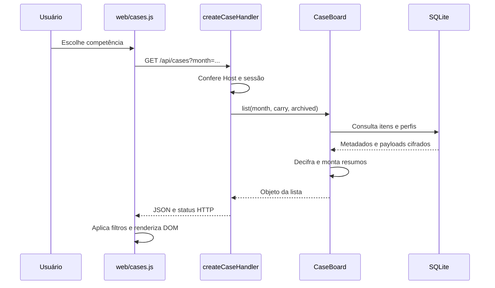

# 4. HTTP, APIs, requests e redes

[Índice](README.md) · [Próximo: interface](05-interface-e-experiencia.md)

## 4.1 Quem conversa com quem?

| Origem → destino | Transporte | Finalidade |
| --- | --- | --- |
| Navegador → Node | HTTP em `127.0.0.1:8767` por padrão | Arquivos da interface e API do painel |
| Node → Ollama | HTTP em `127.0.0.1:11434` por padrão | Consulta de modelo e inferência textual |
| Node → Chrome automatizado | Canal de automação gerenciado por Puppeteer | Operar o cliente WhatsApp Web |
| Chrome automatizado → WhatsApp | Conexões externas administradas pelo cliente web | Sincronização e mensagens |
| Cliente de IA → processo MCP Python | stdio | Invocação de ferramentas de leitura |
| Node/Python → SQLite | Acesso local ao arquivo | Persistência, sem porta de banco |
| OpenCode → provedor selecionado | API remota quando o modelo é remoto | Programação e conversa; cobrança independente |

Loopback é o caminho de rede da própria máquina. Não significa que todos os componentes do produto funcionem offline: WhatsApp e um modelo remoto de programação precisam de conectividade externa. O coletor é independente de manter o OpenCode aberto.

## 4.2 Anatomia de uma URL e de um request

```text
http://127.0.0.1:8767/api/cases?month=2026-11
│      │         │    │          └─ query string
│      │         │    └─ caminho (path)
│      │         └─ porta do processo servidor
│      └─ endereço de loopback
└─ protocolo
```

`GET` consulta uma representação. `POST` submete uma operação. A semântica exata está no handler: o projeto usa POST inclusive para consultar uma extração com uma seleção no corpo. O método sozinho não descreve toda a regra de negócio.

Exemplo **ilustrativo**, em uma sessão já estabelecida, sem credencial real:

```http
GET /api/cases?month=2026-11 HTTP/1.1
Host: 127.0.0.1:8767
Cookie: case_session=<cookie omitido>
```

Resposta simplificada e fictícia:

```http
HTTP/1.1 200 OK
Content-Type: application/json; charset=utf-8
Cache-Control: no-store

{"untrusted":true,"month":"2026-11","items":[]}
```

O status é o resultado HTTP; `Content-Type` descreve a representação; o corpo contém os dados. Um JSON com `ok: true` pode indicar apenas que uma tarefa começou, não que uma conexão ou importação terminou.

## 4.3 Caminho completo de uma consulta



O navegador recebe resumos e fontes permitidas pela rota, não uma conexão SQL. Não há ORM nem Express no caminho descrito: `node:http` e handlers próprios fazem o roteamento.

## 4.4 Catálogo de rotas

Fonte de verdade: [app.mjs](../src/app.mjs) e [cases/http.mjs](../src/cases/http.mjs). `:code` significa código no formato `R-` seguido de oito caracteres hexadecimais maiúsculos; `:n`, índice numérico da fonte.

### Telas

| GET | Tela |
| --- | --- |
| `/` | Configuração e conexão |
| `/chamados` | Central |
| `/historico` | Fontes sem chamado |
| `/fechamento` | Revisão mensal |
| `/minuta` | Minuta imprimível |

### Configuração e coleta — sessão `session`

| Método e rota | Entrada principal | Efeito/retorno |
| --- | --- | --- |
| `GET /api/status` | — | Estado operacional; pode conter QR e grupos, portanto privado |
| `GET /api/month` | query `month` | Até 500 fontes da competência |
| `GET /api/assistant` | — | Estado do assistente e itens |
| `POST /api/connect` | `consent: true` | Inicia vínculo assíncrono |
| `POST /api/select` | `id` de grupo disponível | Fixa o grupo e ativa captura |
| `POST /api/pause` | Corpo JSON | Alterna pausa; não é um setter idempotente |
| `POST /api/questions` | `enabled` booleano | Permissão de mensagens automáticas |
| `POST /api/context` | `id` da fonte | Reavalia fonte sob condições de autorização |
| `POST /api/history` | `month` | Inicia importação de período |

### Central, histórico e fechamento — sessão `case_session`

| Método e rota | Entrada principal | Efeito/retorno |
| --- | --- | --- |
| `GET /api/cases` | `month`, `carry=1`, `archived=1` | Lista e metadados |
| `GET /api/cases/runtime` | — | Conexão e sincronização resumidas |
| `GET /api/cases/:code` | Código no path | Detalhe, contexto, fontes e eventos |
| `POST /api/cases/:code` | `kind`, `version` e campos da operação | Altera perfil, contexto, nota, tarefa, resolução, arquivo/restauração ou união |
| `GET /api/cases/:code/media/:n` | Índice | Imagem validada para visualização |
| `GET /api/cases/:code/attachment/:n` | Índice; `download=1` opcional | Anexo arquivado |
| `POST /api/cases/:code/photo` | Bytes JPEG, PNG ou WebP | Foto local, limite de 5 MB |
| `GET /api/cases/history` | `month`, `offset`, `ignored=1` ou `targets=1` | Fontes sem vínculo ou destinos disponíveis |
| `POST /api/cases/history` | `kind`: `prepare`, `assign`, `ignore`, `restore` ou `recheck` | Operação local sobre o histórico |
| `GET /api/cases/history/media` | `month`, `id`, `ignored`, `download` | Prévia/download elegível |
| `GET /api/cases/closing` | `month` | Revisões, candidatos e verificações |
| `POST /api/cases/closing` | `version`, `kind` e campos específicos | Salva fontes, preventivas, ajustes ou decisão |
| `POST /api/cases/closing/context` | `codes` | Texto de extração e fingerprint |
| `POST /api/cases/closing/package` | `codes`, `fingerprint` | ZIP consistente com extração preparada |
| `POST /api/cases/closing/local` | `codes` com um código | Sugestão textual local, sem aprovação automática |
| `GET /api/cases/closing/draft` | `month` | Dados da minuta, se liberada |
| `GET /api/cases/closing/cover` | `month` | Capa privada, após condições da minuta |

As rotas de fechamento usam `month` na query, inclusive nos POST. Para contratos completos de cada `kind`, leia `CaseBoard.change` e `MonthlyClosing.save`; a tabela não substitui as validações desses métodos.

## 4.5 Um POST de atualização, por dentro

Exemplo fictício de nota; não é instrução para executar na instalação:

```http
POST /api/cases/R-1234ABCD HTTP/1.1
Host: 127.0.0.1:8767
Origin: http://127.0.0.1:8767
Content-Type: application/json
Cookie: case_session=<cookie omitido>

{"kind":"note","version":0,"text":"Aguardando componente para teste.","occurredOn":"2026-11-10"}
```

O handler valida sessão, origem, tipo e limite do corpo. O domínio verifica campos, versão e data. A transação registra o evento e incrementa a versão. A resposta devolve o detalhe atualizado. Um código fictício inexistente retorna erro; não execute este exemplo para experimentar gravação em produção.

## 4.6 Status e diagnóstico

| Status | Leitura neste projeto |
| --- | --- |
| `200` | Operação/consulta respondida |
| `202` | Trabalho aceito para processamento |
| `400` | Entrada inválida ou operação não concluída no handler de configuração |
| `401` | Sessão local ausente/expirada |
| `403` | Host, origem ou operação recusada |
| `404` | Rota, chamado ou recurso indisponível |
| `409` | Conflito de versão, fontes alteradas ou pré-condição de revisão |
| `413` | Corpo ou pacote acima do limite |
| `422` | Contexto/saída de sugestão não utilizável |
| `500` / `503` | Falha interna / serviço de sugestão indisponível |

O frontend precisa verificar `response.ok`: `fetch` pode resolver normalmente mesmo recebendo um erro HTTP. Já falha de transporte costuma rejeitar a Promise.

## 4.7 O papel das proteções do navegador e servidor

- **Bind em loopback:** o servidor escuta `127.0.0.1`, sem oferecer acesso direto à LAN.
- **Host:** valida o endereço esperado recebido no request.
- **Origin:** POST exige a origem exata e o tipo de conteúdo previsto.
- **Cookies:** a configuração usa `session`; a Central usa `case_session`. Abrir uma tela da Central cria sua sessão; não é o mesmo cookie do painel inicial.
- **HttpOnly e SameSite=Strict:** dificultam acesso ao cookie por JavaScript e seu envio em navegações entre sites.
- **CSP:** restringe scripts, conexões, inclusão em frames e outras fontes. É uma defesa adicional, não um substituto da validação.
- **Lista de arquivos estáticos:** o servidor entrega recursos conhecidos, em vez de uma API genérica de leitura de caminhos.

Esses controles são para um painel local. Não representam autenticação de usuários de uma aplicação pública nem isolamento contra processos executando na mesma conta Windows. `localhost` e `127.0.0.1` não são intercambiáveis para uma validação exata de origem; use a URL documentada.

## 4.8 DevTools para aprender

Comece lendo o wrapper `api` em `web/cases.js`. Quando houver autorização para observar uma tela local, abra **Network** nas ferramentas do navegador e identifique método, path, query, status, tipo e tempo. Em **Initiator**, procure qual função iniciou a requisição.

Requests e respostas reais podem conter fontes, cookies, QR e outros dados privados. Para compartilhar uma explicação, reproduza somente a estrutura com dados fictícios; não exporte HAR de produção. O estudo dos handlers e testes sintéticos já permite entender o contrato sem consultar dados reais.
